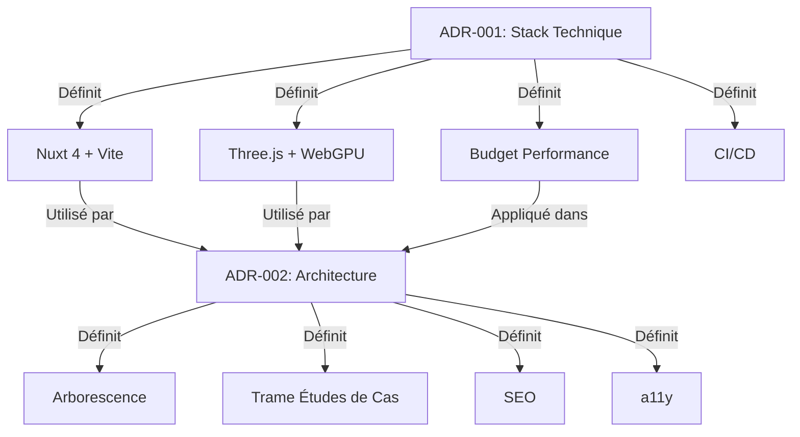

# 📚 Index des ADR (Architecture Decision Records)

> **Documentation Vivante** du Portfolio Adrien Centonze - Tech Lead 3D Web

---

## 🎯 À propos

Les **ADR (Architecture Decision Records)** documentent les **décisions techniques majeures** prises pour ce portfolio. Ils permettent de :
- **Comprendre les choix** architecturaux et leurs justifications.
- **Assurer la cohérence** entre les différentes parties du projet.
- **Faciliter la maintenance** et l'onboarding de nouveaux contributeurs.
- **Suivre l'évolution** du projet dans le temps.

---

## 📋 Liste des ADR

| # | Titre | Statut | Date | Auteur | Dépendances | Priorité |
|---|-------|--------|------|--------|-------------|----------|
| [ADR-001](001-stack-technique.md) | Stack Technique du Portfolio | ✅ **Accepté** | 2025-07-15 | orchestrateur | - | ⭐⭐⭐⭐⭐ |
| [ADR-002](002-architecture-pages.md) | Architecture des Pages | ✅ **Accepté** | 2025-07-15 | orchestrateur | [ADR-001](001-stack-technique.md) | ⭐⭐⭐⭐⭐ |

---

## 🗺️ Carte des Décisions



---

## 📖 Sommaire par Thème

### 🏗️ **Infrastructure & Stack Technique**
- **[ADR-001 : Stack Technique](001-stack-technique.md)**
  - **Framework** : Nuxt 4 + Vite + TypeScript strict
  - **3D** : Three.js + WebGPU (fallback WebGL2)
  - **Outils** : ESLint, Tailwind CSS, @nuxt/content
  - **CI/CD** : GitHub Actions + Lighthouse CI
  - **Budget Performance** : 60 FPS, < 2 Mo JS, ≥ 97 Lighthouse

### 🗺️ **Architecture & Contenu**
- **[ADR-002 : Architecture des Pages](002-architecture-pages.md)**
  - **Arborescence** : `/`, `/projets`, `/taran-core`, `/ia`, `/a-propos`, `/contact`
  - **Trame Études de Cas** : 6 blocs obligatoires (Contexte → Leçons)
  - **Navigation** : Règle des 2 clics, contact en 1 clic
  - **SEO** : Métadonnées, sitemap, Open Graph
  - **Accessibilité** : WCAG 2.1 AA, navigation clavier, contrastes

---

## 🔍 Comment Utiliser les ADR ?

### Pour les **Développeurs**
1. **Avant de coder** : Lire les ADR concernés (ex: avant de travailler sur la 3D, lire [ADR-001](001-stack-technique.md)).
2. **Pendant le développement** : Suivre les **patterns** et **exemples** fournis.
3. **Avant de merger** : Vérifier que le code respecte les **décisions** (ex: code splitting pour Three.js).

### Pour les **Contributeurs**
1. **Proposer une nouvelle décision** : Créer un nouveau fichier `docs/adr/XXX-nouvelle-decision.md` en suivant le [template](#-template-pour-un-nouvel-adr).
2. **Discuter** : Ouvrir une PR avec le label `adr` pour discussion.
3. **Valider** : Une fois accepté, le statut passe à **✅ Accepté**.

### Pour les **Relecteurs**
1. **Vérifier la cohérence** : S'assurer que les ADR ne se contredisent pas.
2. **Tester les exemples** : Les templates et extraits de code doivent fonctionner.
3. **Signaler les obsolescences** : Si une décision n'est plus valide, ouvrir une issue.

---

## 📝 Template pour un Nouvel ADR

```markdown
# ADR-XXX : [Titre de la Décision]

## 📌 Statut
**Proposé** / **En Discussion** / **Accepté** / **Rejeté** / **Obsolète**

---

## 🎯 Contexte
[Expliquer le problème ou l'opportunité qui a conduit à cette décision.]

---

## 🔧 Décision
[Décrire la décision prise, avec des détails techniques si nécessaire.]

---

## ✅ Conséquences

### Avantages
- [Liste des avantages]

### Risques
- [Liste des risques]

### Alternatives rejetées
| Alternative | Raisons du rejet |
|-------------|------------------|
| [Alternative 1] | [Raison] |

---

## 📅 Roadmap
- [ ] [Tâche 1]
- [ ] [Tâche 2]

---

## 🔗 Liens
- [ADR-001](001-stack-technique.md)
- [ADR-002](002-architecture-pages.md)
- [Lien externe 1](https://...)
- [Lien externe 2](https://...)

---

## 📝 Historique
| Version | Date | Auteur | Modifications |
|---------|------|--------|----------------|
| 1.0 | [Date] | [Auteur] | Création initiale |

---
*Créé par : [Ton Nom]*
*Date : [Date]*
```

---

## 🔄 Processus de Mise à Jour

1. **Identifier le besoin** : Une nouvelle décision est nécessaire ?
2. **Créer un ADR** : Utiliser le template ci-dessus.
3. **Discuter** : Ouvrir une PR avec le label `adr`.
4. **Valider** : Une fois le consensus atteint, le statut passe à **✅ Accepté**.
5. **Implémenter** : Mettre en œuvre la décision dans le code.
6. **Documenter** : Mettre à jour les ADR existants si nécessaire.

---

## 🛠️ Outils pour Vérifier les ADR

### Script de Vérification Automatique
```bash
#!/bin/bash
# scripts/verify-adrs.sh

# Vérifier que tous les liens entre ADR sont valides
echo "🔍 Vérification des liens entre ADR..."
grep -r "ADR-" docs/adr/*.md | grep -o "ADR-[0-9]\+" | sort -u | while read adr; do
  if [ ! -f "docs/adr/${adr}.md" ]; then
    echo "❌ Lien invalide : ${adr}"
    exit 1
  fi
done
echo "✅ Tous les liens entre ADR sont valides"

# Vérifier que les décisions sont implémentées
echo "🔍 Vérification de l'implémentation des décisions..."

# Exemple : Vérifier que target: 'static' est dans nuxt.config.ts
if ! grep -q "target: 'static'" nuxt.config.ts; then
  echo "❌ ADR-001 : target: 'static' non implémenté dans nuxt.config.ts"
  exit 1
fi

# Exemple : Vérifier que @nuxt/image est dans package.json
if ! grep -q "@nuxt/image" package.json; then
  echo "❌ ADR-001 : @nuxt/image non installé"
  exit 1
fi

echo "✅ Toutes les décisions vérifiées sont implémentées"
```

### Intégration dans CI/CD
Ajouter le script ci-dessus dans `.github/workflows/verify-adrs.yml` :
```yaml
name: Verify ADRs
on: [push, pull_request]

jobs:
  verify:
    runs-on: ubuntu-latest
    steps:
      - uses: actions/checkout@v4
      - run: chmod +x scripts/verify-adrs.sh
      - run: ./scripts/verify-adrs.sh
```

---

## 📊 Statistiques

| Métrique | Valeur |
|----------|--------|
| **Nombre d'ADR** | 2 |
| **Nombre d'ADR Acceptés** | 2 |
| **Nombre d'ADR Obsolètes** | 0 |
| **Dernière mise à jour** | 2025-07-15 |

---

## 🤝 Contributeurs

| Rôle | Responsable | Contact |
|------|-------------|---------|
| **Orchestrateur** | orchestrateur | [GitHub](https://github.com/adricen) |
| **Tech Lead 3D** | @threejs-agent | - |
| **Contenu** | @contenu-agent | - |
| **DevOps** | @devops-agent | - |
| **SEO/a11y** | @seo-agent | - |

---

## 📚 Ressources Externes

### Documentation Officielle
- [Nuxt 4 Documentation](https://nuxt.com/docs)
- [Three.js Documentation](https://threejs.org/docs)
- [WebGPU Specification](https://gpuweb.github.io/gpuweb/)
- [WCAG 2.1 Guidelines](https://www.w3.org/WAI/WCAG21/quickref/)
- [Google SEO Starter Guide](https://developers.google.com/search/docs/fundamentals/seo-starter-guide)

### Outils
- [Lighthouse CI](https://github.com/GoogleChrome/lighthouse-ci)
- [WAVE Accessibility Tool](https://wave.webaim.org/)
- [Screaming Frog SEO Spider](https://www.screamingfrog.com/seo-spider/)
- [Mermaid Live Editor](https://mermaid.live/) (pour les diagrammes)

---

## 💡 Bonnes Pratiques

1. **Un ADR = Une Décision** : Chaque ADR doit traiter **une seule décision majeure**.
2. **Soyez Concis** : Un ADR doit tenir en **1-2 pages max**.
3. **Utilisez des Exemples** : Code, schémas, templates pour illustrer.
4. **Mettez à Jour** : Si une décision change, mettez à jour l'ADR (ne le supprimez pas).
5. **Liez les ADR** : Référencez les ADR dépendants (ex: "Voir [ADR-001](001-stack-technique.md)").
6. **Documentez les Alternatives** : Expliquez pourquoi les autres options ont été rejetées.

---

## 🚀 Prochaines Étapes

| Tâche | Priorité | Responsable | Échéance |
|-------|----------|-------------|----------|
| Implémenter [ADR-001](001-stack-technique.md) | ⭐⭐⭐⭐⭐ | @nuxt-agent | Semaine 1-2 |
| Implémenter [ADR-002](002-architecture-pages.md) | ⭐⭐⭐⭐⭐ | @contenu-agent | Semaine 2-3 |
| Créer un script de vérification des ADR | ⭐⭐ | @devops-agent | Semaine 1 |
| Ajouter un ADR pour le design system | ⭐⭐ | @ui-agent | Semaine 3 |

---

*Dernière mise à jour : 2025-07-15*
*Responsable : orchestrateur*
